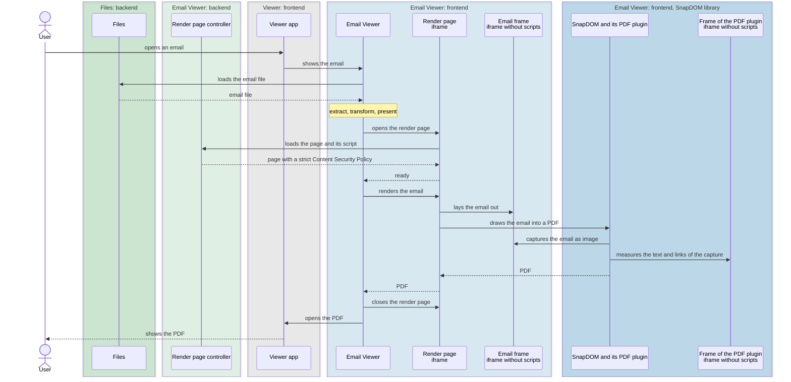

<!--
SPDX-FileCopyrightText: 2026 Nextcloud GmbH and Nextcloud contributors
SPDX-License-Identifier: AGPL-3.0-or-later
-->

# Development

## Building the app

```sh
npm ci
npm run build
```

## How an email is rendered

Email Viewer converts an email to a PDF in the browser and shows the PDF in the PDF Viewer.
The conversion has four steps:

1. **Extract**: reads the body, metadata and attachments of the email.
2. **Transform**: sanitizes the HTML body and embeds its inline images.
3. **Present**: adds a header with the metadata and a list of the attachments.
4. **Render**: lays the email out and draws it into a PDF with SnapDOM, in a separate render page.

### Sequence



## Tests

```sh
# unit tests with Vitest, `*.test.ts`
npm test
# browser tests with Playwright in Chromium, `*.browser.test.ts`
npx playwright install chromium
npm run test:browser
# after an intended change of the rendering, to update the PDFs in tests/fixtures/rendering-snapshots
npm run test:browser -- --update-snapshots
```

Most test cases are written declaratively in YAML files, without code:

- `tests/fixtures/extract/*.yaml`: emails and what is extracted from them.
  An email is either written out as `.eml` source, or is an `.msg` file in `tests/fixtures/parsing-examples`.
- `tests/fixtures/transform/*.yaml`: HTML and how it looks after sanitizing.

The rendering test cases are plain files in `tests/fixtures/rendering-examples`: emails and HTML pages.
Each one is rendered to a PDF and compared with its snapshot in `tests/fixtures/rendering-snapshots`.

To add a test case, add an entry to a YAML file or a file to `tests/fixtures/rendering-examples`.

## Security

Emails are untrusted. Attacks and their mitigations:

- **Cross-site scripting**
  - DOMPurify removes scripts and event handlers.
  - The Content Security Policy of the render page only allows its own script.
  - The email frame is sandboxed without `allow-scripts`.
- **HTTP leaks**
  - URLs in `src`, `background` and `poster` are emptied, besides `data:` URLs and inline attachments.
  - `<style>` elements are removed.
  - The Content Security Policy blocks all other external resources.
- **Harmful links**
  - Only `http:`, `https:` and `mailto:` links are kept.
- **Submitting data**
  - Forms are removed, and the Content Security Policy blocks form submissions.
